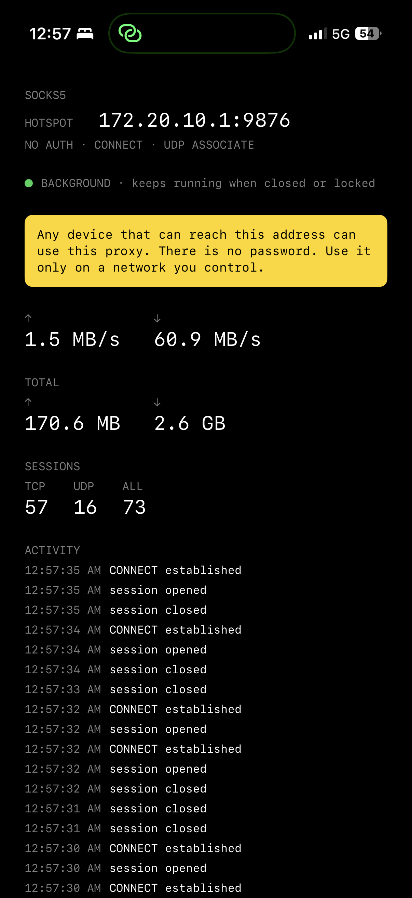

# ios-hotspot-proxy-app

A SOCKS5 proxy that runs on your **iPhone** so a tethered **Linux laptop** can
send its traffic out over the phone's cellular data.

It replaces this chain:

```
privoxy → ssh -D → iSH sshd
```

with one app and one SOCKS5 port.



## Why this exists

Two reasons, and the second is the important one.

**1. Tethering detection.** When you tether a laptop to your phone, the phone
*forwards* the laptop's packets to the carrier. They arrive carrying the
laptop's TCP/IP fingerprint and a TTL one hop lower than anything the phone
sends itself. That difference is what tethering detection looks for.

**2. The carrier throttle.** Tethering through **Personal Hotspot** is billed and
metered as hotspot traffic on many carriers, and some carriers throttle it hard.
This app avoids the Personal Hotspot data path entirely — the traffic leaves as
ordinary phone cellular data.

That avoidance is what drives the unusual topology below.

## The topology is reversed — read this before anything else

> **The laptop hosts the WiFi access point. The phone joins it as a client.**

This is **opposite** to how this project is normally used, and it is
intentional.

Normally: phone runs the hotspot → laptop connects to it. Here: laptop runs the
hotspot → phone connects to it.

```
  ┌──────────────┐   WiFi (no uplink)   ┌──────────────────────────┐
  │    LAPTOP    │ ────────────────────▶ │         iPHONE           │
  │  hosts the   │                       │  SocksBypass listens      │
  │   access pt  │ ◀──────────────────── │  0.0.0.0:9876            │
  └──────────────┘   SOCKS5 over LAN     └────────────┬─────────────┘
       │                                             │ cellular
       │  SOCKS5_PROXY=socks5h://<phone-ip>:9876    ▼
       └──────────────────────────────────▶    carrier → internet
```

Why invert it:

- If the phone ran **Personal Hotspot**, the carrier would meter the laptop's
  traffic as hotspot traffic and the throttle comes right back.
- So the phone must **join** a network instead of serving one.
- The laptop's access point has **no internet uplink** — it only carries the
  SOCKS5 session.
- With no uplink on WiFi, iOS fails over to cellular implicitly. Outbound
  traffic has exactly one route out: the radio.

That implicit failover is why the app works. The upstream connection is also
pinned to cellular explicitly (see [Known gaps](#known-gaps)), which turns the
same guarantee from a heuristic into an enforced one.

### Setting it up

1. On the **laptop**, start a WiFi access point (`create_ap`, `hostapd`,
   NetworkManager, whatever you prefer). It does not need internet.
2. On the **iPhone**, join that access point.
3. Open SocksBypass and start the relay. It binds `0.0.0.0:9876`.
4. Note the iPhone's address on that network.
5. On the **laptop**, point your client at it:

   ```bash
   export SOCKS5_PROXY=socks5h://192.168.x.y:9876   # the iPhone's address
   curl --socks5-hostname 192.168.x.y:9876 https://ifconfig.co
   ```

   Confirm the egress IP is your **phone's** carrier IP, not the laptop's.

The relay also supports **UDP ASSOCIATE**, so DNS over UDP works too.

## ⚠️ No password. Read before you run this.

**The listener binds `0.0.0.0` and there is NO authentication of any kind.**

Anything that can reach the phone's address on that port can use it as an **open
relay** — through the phone's cellular data, on your account. No password, no
token, no IP allowlist, no rate limit.

**Only run this on a network you control.** Concretely:

- Do **not** enable the relay on hotel, café, university, airport, or office
  WiFi.
- Do **not** enable it while the phone is on a carrier network or any other
  untrusted network — the bind is not restricted to the WiFi interface.
- Be aware that the phone joins your laptop's AP, so anyone within radio range
  of the laptop can reach the phone.

The safest pattern is to start the relay only for the duration you need it, and
stop it when you are done.

## Build

There is **no shared `SocksBypass` scheme**. The only shared scheme is
`SocksBypass-Benchmark`, whose archive action is pinned to a build configuration
that links `Vendor/HevSocks5Server.xcframework` — a gitignored, uncommitted
binary that does not exist in a fresh clone. So `-scheme` cannot build this
project. Everything below builds by `-target` and zips the `.app` by hand.

### In CI (recommended)

Push to `main`, or run the **build-ios** workflow manually. It builds an unsigned
device `.ipa` on `macos-latest` and uploads it as the artifact
`SocksBypass-unsigned-ipa`.

CI holds **no Apple credentials** — no Apple ID, no certificate, no provisioning
profile, no secrets. It sets `CODE_SIGNING_ALLOWED=NO` and
`CODE_SIGNING_REQUIRED=NO`. Signing happens on your Linux box, later.

The underlying command is:

```sh
xcodebuild \
  -project SocksBypass.xcodeproj \
  -target SocksBypass \
  -configuration Release \
  -sdk iphoneos \
  ARCHS=arm64 \
  CODE_SIGNING_ALLOWED=NO \
  CODE_SIGNING_REQUIRED=NO \
  build
```

### On a Mac

```sh
./scripts/build-ipa.sh
```

Same flags, same result. It prints the exact path of the `.ipa` it produced.

Both paths emit `SocksBypass-unsigned.ipa`, which is a zip containing
`Payload/SocksBypass.app`. It is unsigned and will not install as-is.

## Install and keep it installed: SideStore

The reason CI holds no credentials: a **free Apple ID** signs an app for only
**7 days**, and signing cannot be automated on a free account (see
[Why not sign in CI](#why-not-sign-in-ci)). Left alone, that means a weekly
manual ritual.

**SideStore removes the ritual entirely, and it costs nothing.**

[SideStore](https://sidestore.io/) is MIT-licensed and free forever — no
premium tier. (If you have seen a paid "AltStore Premium" at $10/year, that is a
different product; SideStore is a fork of AltStore that exists specifically to
drop that upsell *and* the tethered-computer requirement.) SideStore is an app
on the phone that re-signs and re-installs other apps using your Apple ID,
refreshing them over Wi-Fi before the 7-day profile lapses.

The 7-day expiry still exists in Apple's terms. SideStore just handles it without
you. **No credentials live on your Linux box and none live in CI.** That is what
turns this from a weekend experiment into something you can leave running.

### Prerequisites

- iOS 15.0 or newer, **with a passcode set** — SideStore requires one.
- `LocalDevVPN` from the App Store. It must be connected during installs and
  refreshes.
- **Wi-Fi only.** The refresh path is unsuitable over mobile data.
- [`iloader`](https://github.com/nab138/iloader) on a desktop machine. It is
  MIT-licensed and **Linux is supported**.
- Developer Mode enabled on the iPhone: Settings → Privacy & Security →
  Developer Mode. The phone asks you to reboot.

### One-time setup

1. Install `iloader` and plug the iPhone in over USB.
2. Sign in with your Apple ID. **This is the only time the Apple ID is ever typed
   on your Linux machine.**
3. `iloader` installs SideStore and pairs the device so SideStore can install
   for itself.
4. Install and keep `LocalDevVPN` connected.

`iloader`'s UI steps vary by version; follow its own README for the exact
sequence rather than trusting a transcription of it here.

### Install this app, and every refresh after it

1. Download the unsigned `.ipa` from a CI run:

   ```sh
   gh run download <run-id> -D ./art
   ```

   Run it **from inside a git repo**, or pass `-R <owner/repo>`. Otherwise it
   fails with `fatal: not a git repository`.

2. Get the file onto the phone. Any method that lands it in the **Files** app
   works — AirDrop, iCloud Drive, a cable — because SideStore imports from there.

3. In SideStore: **My Apps** → **`+`** → pick the `.ipa`. SideStore signs and
   installs it on the device.

4. Confirm it works: the app should display the address and port your laptop
   should dial, default **9876**.

Then **do nothing.** SideStore refreshes over Wi-Fi in the background.

Two things to know about the refresh:

- **Keep the bundle ID fixed.** Free accounts get 10 App IDs per 7 days;
  re-signing the same bundle ID reuses the same App ID. Changing it burns a new
  one every time.
- **Keep `LocalDevVPN` connected.** Without it, refreshes fail.

If a refresh ever does fail, the fix is to re-import the `.ipa` from the Files
app.

> **Gotcha, if your own internet is proxied.** `gh` is a Go binary, and Go's
> HTTP client honours `HTTPS_PROXY` — **not** `ALL_PROXY`. If your only route to
> the internet is a SOCKS proxy, `gh` will report `error connecting to
> api.github.com` and then `gh auth status` will claim your token is invalid.
> Both messages are lies. Set `HTTPS_PROXY` as well.

## Fallback: signing and installing on Linux

If SideStore does not suit you, the next best thing is a weekly command. It is
still better than signing by hand, because the credential is cached after the
first use.

1. **Enable Developer Mode on the iPhone.** Settings → Privacy & Security →
   Developer Mode.

2. **Get [Legacy iOS Kit](https://github.com/LukeZGD/Legacy-iOS-Kit).** It runs
   on Linux and drives [Plumesign](https://github.com/declaration/Impactor) for
   the signing half. (The old `khcrysalis/PlumeImpactor` URL redirects there.)

3. **Run it**, choose **Sideload IPA**, select `SocksBypass-unsigned.ipa`, then
   **Install IPA using Plumesign**. Trust the computer when the phone asks,
   enter your Apple ID and password, and a 2FA code if prompted.

4. **Trust the profile:** Settings → General → VPN & Device Management.

Linux prerequisites: `usbmuxd` installed, and the phone plugged in before you
start — on distros where udev rules interfere, the device is not seen otherwise.
iTunes is not required on Linux. **Sideloadly is not available on Linux**; do
not go looking for it.

### Why the weekly part is just a command

After the first login, Plumesign stores a session in
`~/.config/PlumeImpactor/accounts.json`, and signing reuses it with
`sign --apple-id` **without re-prompting for the password or a 2FA code**. So you
type a 2FA code once, not weekly.

**The wart:** that stored session has **no tracked expiry field**. Plumesign
discovers it when Apple rejects the token, at which point you get a surprise
2FA prompt at an unpredictable cadence. That is the main operational downside of
this path and the reason SideStore is preferred.

(When a code *is* needed it is read from **stdin** — there is no CLI flag for
it. Pipeable, but not flaggable.)

### Know the 7-day expiry

A free-Apple-ID signature **expires after 7 days**, at which point the app stops
launching until it is signed and reinstalled. The only ways out are SideStore,
which handles it for you, or a paid Apple Developer account at $99/year, which
signs for a year. SideStore gets you there for free.

## Why not sign in CI

This comes up, so the short version:

- **A free Apple ID's second factor is required at Apple's _login_ step**, not
  the signing step, and a human reads it off a device. It cannot be stored.
- **The 2FA code rotates every ~30 seconds**, so there is nothing static to bake
  into a workflow.
- **Anisette** — the iTunes-fingerprint blob these tools use — is *not* a
  substitute for the second factor. It is required on every request and comes
  from third-party servers that see your IP. Community anisette servers have
  historically caused Apple ID lockouts.
- **CI could never install the app anyway.** Signing is only half the operation;
  installing needs the physical device. "Sign in CI, then sideload" was always
  two steps, and the sideload step is unavoidably local. SideStore is the only
  option that collapses both halves into the device.
- **A paid account does fix the signing half** — `plumesign sign --pem-files …
  --provision …` is fully offline, with no login, no anisette and no 2FA — but
  it costs $99/year and still does not remove the local install step. It buys
  less than SideStore for this goal.

## Known gaps

Things that are **not** fixed in this fork. Read before relying on them.

### 1. The cellular pin is TCP-only — UDP egress is unpinned

Outbound **TCP** connections are pinned to cellular with
`requiredInterfaceType = .cellular`. Outbound **UDP** is not.

`UdpAssociation.swift` does not use Network.framework at all — it owns a raw
BSD socket (`Darwin.socket(AF_INET6, SOCK_DGRAM, IPPROTO_UDP)`) and uses
`sendto`. `requiredInterfaceType` has no equivalent there short of
`IP_BOUND_IF`-style socket options, which is a much larger change than this
fork is making.

On this topology it does not matter in practice — the laptop's access point has
no uplink, so WiFi cannot carry UDP out either, and it fails over to cellular
implicitly like everything else. But the guarantee is **not** enforced for UDP.
Anything that changes that assumption could regress DNS-over-UDP quietly.

### 2. There is no authentication. See the warning above.

Not a gap to be fixed later — a property of the design. Listed here so it is not
mistaken for an oversight.

### 3. The background keepalive is ~90 % reliable, not certain

`BackgroundKeepAlive` keeps the app alive by looping a **real, low-level tone**
through `AVAudioEngine` in an `.playback` `AVAudioSession`, with
`UIBackgroundModes: [audio]` declared in `SOCKS/Info.plist`. The tone is −40 dBFS
peak of band-limited noise, crossfaded so the loop seam is not a click, re-armed
on every audio-session notification, and watched by a 1 Hz timer off the main
thread. Full rationale, and what was deliberately not built, is in
[`docs/KEEPALIVE-TODO.md`](docs/KEEPALIVE-TODO.md).

**The residual risk is that iOS 26 has been observed killing this setup anyway.**
An Apple Developer Forums report (thread 826462, iPhone 17 Pro Max, iOS 26.5)
records a SIGKILL at approximately 50 seconds of background time in an app that
had *everything* nominally correct:

> `UIBackgroundModes` includes audio (verified in shipping IPA's Info.plist);
> `AVAudioSession.setCategory(.playAndRecord, mode: .default)` is active;
> `AVAudioEngine` is running with `installTap` producing PCM buffers right up to
> the moment of death; `UIApplication.backgroundTimeRemaining` returns
> `Double.greatestFiniteMagnitude` at `applicationDidEnterBackground`; no
> `AVAudioSession.interruptionNotification` is delivered before the kill.

That poster tried 35 documented workarounds — `BGContinuedProcessingTask`, Live
Activity, WebRTC, `voip`, `beginBackgroundTask`, background location — and
reported that **all of them die at ~50 s**. Meanwhile three shipping App Store
transcription apps on the *same device and iOS version* survive indefinitely with
`UIBackgroundModes: audio`. **No distinguishing factor was identified**, by that
poster or in this fork's research.

So treat the keepalive as approximately 90 % reliable, not as a guarantee.
Concretely, this means:

- The **auto-re-arm** is load-bearing, not a nicety. If the engine or player is
  found not running, it restarts within a second.
- The **`isIdleTimerDisabled` foreground path** is a real fallback, not a
  convenience — while the app is in front with the screen on, no OS heuristic can
  take it away.
- Do not design around the session surviving indefinitely without a way to notice
  that it did not. The in-app log and the traffic counters are how you find out
  how long a session actually lasted.

Known and specific: combining the keepalive with a background `URLSession` using
`sessionSendsLaunchEvents = true` is reported to kill background playback ~1 ms
after the `handleEventsForBackgroundURLSession` completion handler runs, in a
process that was launched into the background and never went foreground
(thread 838240, FB23789310). This app uses no background `URLSession`, so it does
not apply — but do not add one casually.

### 4. Local Network permission: not needed inbound, silently denied outbound

Per TN3179 (Apple, *Understanding local network privacy*), the permission applies
asymmetrically:

- **Listening for and accepting incoming TCP connections requires no
  local-network permission.** The inbound SOCKS listener on port 9876 therefore
  never triggers the permission prompt, and never has anything revoked out from
  under it.
- **Outbound connections to local-network destinations do require it.** That is
  the SOCKS `CONNECT` leg and the UDP `ASSOCIATE` path. Pointing the proxy at a
  `192.168.x.x` target is a local-network operation.
- When the privilege is still **undetermined** and the app is in the background,
  **the system denies the operation silently, without showing the alert.** If a
  user never granted Local Network access, a backgrounded app will not prompt —
  it will just fail to reach a local target, with no user-visible explanation.

Consequence for this app: `NSLocalNetworkUsageDescription` in `SOCKS/Info.plist`
is **harmless but not strictly required** for normal use, because the only
unconditional listener is inbound. It is kept because the outbound leg can hit
the local network and because omitting it makes that failure worse. Note also
that TN3179 covers only the permission gate; it says nothing about suspension, so
Local Network privacy is not a factor in the keepalive at all.

### 5. UDP ASSOCIATE is untested against a real carrier network

The SOCKS5 path is exercised by upstream's `Bench/` oracle and unit tests. The
end-to-end tethering path — a real laptop, a real phone, a real carrier — has not
been run from this fork.

### 6. No scheme-based tooling

Because there is no `SocksBypass` scheme, anything expecting one will not work
out of the box: `xcodebuild -scheme`, Xcode's normal run/install flow, and most
CI templates. Use `-target` (see [Build](#build)). The upstream
`SocksBypass-Benchmark` scheme and the Android tree are not part of this fork.

### 7. SideStore is a dependency, and it is not free of constraints

The install path depends on a third-party app
([SideStore](https://sidestore.io/)), which is free and MIT-licensed but outside
our control. Two standing costs: **LocalDevVPN must be connected** for installs
and refreshes to work at all, and free accounts get **3 app slots total
including SideStore itself**. We use one, so the budget is comfortable — but this
app cannot be a fourth sideload. If SideStore breaks on a future iOS release,
the [Linux fallback](#fallback-signing-and-installing-on-linux) is the way back.

### 8. The laptop side needs its own proxy configuration

The phone serving SOCKS5 is half of the story. Getting *every* process on the
laptop through it — including applications that ignore proxy settings, which is
what most games do — needs a local TUN device and a translator such as
`sing-box`. That is deliberately **not** part of this repository, which builds
the phone app only. Until it is set up, expect to route proxy-aware clients
individually.

## Upstream and license

This project is a fork of **[SocksBypass](https://github.com/Nanako0129/SocksBypass)**,
which is itself a Swift rewrite of
**[nneonneo/socks5-ios](https://github.com/nneonneo/socks5-ios)**.

All source under `SOCKS/`, `SocksBypass.xcodeproj/`, `SocksBypassTests/`,
`Bench/`, `docs/`, and `scripts/` originates from SocksBypass and is unmodified
except where a diff against upstream says otherwise.

MIT licensed throughout — see [`LICENSE`](LICENSE). The Xcode project is a
derivative of the upstream Swift rewrite, and the SOCKS5 protocol handling has
historical roots in `nneonneo/socks5-ios`; both are MIT, and both are credited
there. Third-party notices for vendored components are in
[`ThirdPartyNotices/`](ThirdPartyNotices) — note those cover
`HevSocks5Server`/`HevSocks5Core`/`HevTaskSystem`, which are only used by the
Benchmark configuration that this fork does not build.